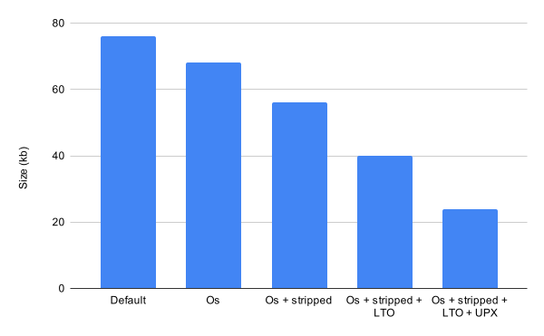

I was wondering how small it was possible to make could get a non trivial program, without actually changing the code itself, ie: mostly compiler flags and such.
I might be using "non trivial" wrongly here but I mean a program that can actually do something.

Well, let us start with a non trivial program and go from there,
For this I will make use of the wonderful [tigr graphics library](https://github.com/erkkah/tigr)

```c
#include <stdlib.h>
#include "tigr.h"
#include <time.h>
#include <stdio.h>

int randomNo(int min, int max) {
  return min + rand() / (RAND_MAX / (max - min + 1) + 1);
}

int main() {

  srand(time(NULL));

  Tigr *screen = tigrWindow(320, 240, "Hello", 0);
  int x, y;
  char *fmt = malloc(100);
  while (!tigrClosed(screen)) {
    tigrClear(screen, tigrRGB(0x11, 0x11, 0x11));

    tigrPrint(screen, tfont, 120, 110, tigrRGB(0xf0, 0xf0, 0xf0),
              "Hello, world.");
	snprintf(fmt, 100, "%d, %d", x, y);
	tigrPrint(screen, tfont, 120, 110 + 16, tigrRGB(0xf0, 0xf0, 0xf0), fmt);

    tigrMouse(screen, &x, &y, NULL);
    tigrFillCircle(screen, x, y, 8, tigrRGB(0xff, 0x00, 0x00));

    for (int i = 0; i < 100; i++) {
      int x = randomNo(0, 320);
      int y = randomNo(0, 240);
      tigrLine(screen, x, y, x, y + 10, tigrRGB(0x00, 0x00, 0xff));
    }

    tigrUpdate(screen);
  }
  free(fmt);
  tigrFree(screen);
  return 0;
}
```
Nothing flashy, it just opens a window, draws some text and some rain.
Compiling with `cc app.c tigr.c -o app -lGl -lX11` gives us our executable, whose size is 76kb.

For such a simple program, surely we can do better right?

## Compiler Flags

### -Os
How about telling the compiler to optimize for size with the `-Os` flag?
With it, The new binary is 68kb, a decrease of 10.52%, Not bad if I say so myself.
However in my experience this doesnt always happen, quite often the decrease is so small, that it won't even be measured.

You can find out what it does by starting from here, https://gcc.gnu.org/onlinedocs/gcc/Optimize-Options.html#Optimize-Options

### -s
Despite adding `-Os`, the compiler still adds in a bunch of debug information that we don't really need, so if we ask we can `strip` it from the binary.

Adding it via the compiler flag `-s`, We get a binary 26% smaller than the 76kb original, not bad.
(Instead of the compiler flag, you can use `-s` on a compiled binary.)

You can sort of see this with the `strings` utility, initially our binary contained 1363 strings, after stripping it contained 339.

Following the saying, "Good artists create, Great artists steal", Consulting https://github.com/johnthagen/min-sized-rust , We find one thing of interest, Link Time Optimization (LTO)..

### -flto
Basically this tells the linker to apply optimizations during linking time. It's more complicated than that but I don't understand it.

So what does it do for us?
Quite a bit, Using it we have shaved off 16kb to reach 40kb, so in total (with -Os and -s) a 47% decrease of our initial 76kb, not bad at all.

**NOTE**: Enabling `-flto` sometimes caused me a segfault at program start with clang, but this didnt occur with GCC, so it seems like GCC has a more mature implementation.

## Executable Packing
If you wanted to go even furthur you could try [UPX](https://upx.github.io/), Which actually compresses your biniary and this works since
the decompression code + compressed data ends up smaller than the initial binary.

Although some would consider this cheating, It is still a legtimate method and does work,
Running it with the highest compression level (-9) on our 40kb binary yields a binary size of 24kb, A decrease of 60% which is undeniably really impressive.

**NOTE:** Since upx is often used in malware, There are chances it might get flagged by an antivirus,
But running through virus total shows only [results](https://is.gd/MtqIMG) from Google & Ikarus(?)

**NOTE:** In a web enviroment, files are usually transferred while being gzip-compressed, UPX would be negligible for .wasm files and it doesnt support it anyway.

 

## Compression & Linker [UPDATE - 19-08-2025]
Seeing as I had put UPX as a possibility, It only felt right to also have other compression methods so I'm including some of the ones I had installed (`7z`, `zstd`, `xz`, `bzip2`, `gz`) which together should give a good idea of how much it can be further compressed, all were used at their highest settings

I have re-run the experiment and noticed that using `lld` and `clang` gave the best results (now that clang's LTO has been resolved) I also put as many size optimization related flags for `lld` that I could find

<x-chart unit="B" title="File size by compression/build type">
build	size
7z	14778
xz	15100
zst	16497
gz	17448
bz2	17998
upx	20320
linker	32312
-flto	32360
-s	39448
-Os	49088
source	53107
basic	68120
</x-chart>

<x-table>
size	filename
14778	basic-optimized-stripped-lto-linker.7z
15100	basic-optimized-stripped-lto-linker.xz
16497	basic-optimized-stripped-lto-linker.zst
17448	basic-optimized-stripped-lto-linker.gz
17998	basic-optimized-stripped-lto-linker.bz2
20320	basic-optimized-stripped-lto-linker-upx
32312	basic-optimized-stripped-lto-linker
32360	basic-optimized-stripped-lto
39448	basic-optimized-stripped
49088	basic-optimized
53107	source-code.tar.gz
68120	basic
</x-table>

You can see all the commands that I used for each one here,
<x-fold title="Makefile">
```make
CC=clang
# SOURCES=./hw.c
SOURCES=./src.c ./tigr.c
LIBS=-lGLU -lGL -lX11
BASIC_CC = ${CC} ${SOURCES} ${LIBS} -march=native -fuse-ld=lld

all: build-all

basic:
	@echo "\033[1m$@:\033[0m"
	mkdir -p out
	${BASIC_CC} -o out/basic
	
BASIC_OPTIMIZED_CC = ${BASIC_CC}  -Oz -fno-ident -fno-asynchronous-unwind-tables 
basic-optimized:
	@echo "\033[1m$@:\033[0m"
	mkdir -p out
	${BASIC_OPTIMIZED_CC} -o out/basic-optimized

BASIC_OPTIMIZED_STRIPPED_CC = ${BASIC_OPTIMIZED_CC} -s
basic-optimized-stripped:
	@echo "\033[1m$@:\033[0m"
	mkdir -p out
	${BASIC_OPTIMIZED_STRIPPED_CC} -o out/basic-optimized-stripped

BASIC_OPTIMIZED_STRIPPED_LTO_CC = ${BASIC_OPTIMIZED_STRIPPED_CC} -flto
basic-optimized-stripped-lto:
	@echo "\033[1m$@:\033[0m"
	mkdir -p out
	${BASIC_OPTIMIZED_STRIPPED_LTO_CC} -o out/basic-optimized-stripped-lto

BASIC_OPTIMIZED_STRIPPED_LTO_LINKER_CC = ${BASIC_OPTIMIZED_STRIPPED_LTO_CC} -z noseparate-code -Wl,--gc-sections -Wl,--strip-all -Wl,--icf=all -Wl,--lto-O3 -Wl,-O2
basic-optimized-stripped-lto-linker:
	@echo "\033[1m$@:\033[0m"
	mkdir -p out
	${BASIC_OPTIMIZED_STRIPPED_LTO_LINKER_CC} -o out/basic-optimized-stripped-lto-linker

basic-optimized-stripped-lto-linker-compressed-zstd: basic-optimized-stripped-lto-linker
	@echo "\033[1m$@:\033[0m"
	zstd -22 --ultra -f out/basic-optimized-stripped-lto-linker -o out/basic-optimized-stripped-lto-linker.zst

basic-optimized-stripped-lto-linker-compressed-gz:
	@echo "\033[1m$@:\033[0m"
	rm -f out/basic-optimized-stripped-lto-linker.gz
	gzip --best -f out/basic-optimized-stripped-lto-linker -c > out/basic-optimized-stripped-lto-linker.gz

basic-optimized-stripped-lto-linker-compressed-xz:
	@echo "\033[1m$@:\033[0m"
	rm -f out/basic-optimized-stripped-lto-linker.xz
	xz -e -k -9 out/basic-optimized-stripped-lto-linker

basic-optimized-stripped-lto-linker-compressed-bzip2:
	@echo "\033[1m$@:\033[0m"
	rm -f out/basic-optimized-stripped-lto-linker.bz2
	bzip2 -k --best ./out/basic-optimized-stripped-lto-linker

basic-optimized-stripped-lto-linker-compressed-7z:
	@echo "\033[1m$@:\033[0m"
	rm -f out/basic-optimized-stripped-lto-linker.7z
# 	7z a -mx=9 -m0=LZMA2 -mfb=64 -md=64k out/basic-optimized-stripped-lto-linker.7z out/basic-optimized-stripped-lto-linker
	7z a -mx=9 out/basic-optimized-stripped-lto-linker.7z out/basic-optimized-stripped-lto-linker

basic-optimized-stripped-lto-linker-compressed-upx: basic-optimized-stripped-lto-linker
	@echo "\033[1m$@:\033[0m"
	rm -f out/basic-optimized-stripped-lto-linker-upx
	upx --ultra-brute --no-lzma out/basic-optimized-stripped-lto-linker -o out/basic-optimized-stripped-lto-linker-upx

source-code:
	@echo "\033[1m$@:\033[0m"
	mkdir -p out
	cp makefile src.c tigr.c tigr.h out/
	tar -czf out/source-code.tar.gz -C out makefile src.c tigr.c tigr.h
	rm out/makefile out/src.c out/tigr.c out/tigr.h

build-all: basic \
			basic-optimized basic-optimized-stripped \
			basic-optimized-stripped-lto \
			basic-optimized-stripped-lto-linker \
			basic-optimized-stripped-lto-linker-compressed-zstd \
			basic-optimized-stripped-lto-linker-compressed-upx \
			basic-optimized-stripped-lto-linker-compressed-gz \
			basic-optimized-stripped-lto-linker-compressed-xz \
			basic-optimized-stripped-lto-linker-compressed-bzip2 \
			basic-optimized-stripped-lto-linker-compressed-7z \
			source-code
	@echo "\033[1m$@:\033[0m"
	du -b out/*

clean:
	@echo "\033[1m$@:\033[0m"
	rm -rf out
```
</x-fold>

## Conclusion
So in total we managed to decrease our binary by **68%** without changing a single line of code, Less than half of its original size
I am very pleased with that..

Of course, even this isn't anything compared to marvellous feats of engineering like [.kkreiger](https://en.wikipedia.org/wiki/.kkrieger), A entire 3d fps game demo in a extremely impressive 95kb,
When code is *actually written* to be small, and optimized to the limit towards that purpose.
More on why:
- https://fgiesen.wordpress.com/2012/02/13/debris-opening-the-box/
- https://fgiesen.wordpress.com/2012/04/08/metaprogramming-for-madmen/
- https://www.youtube.com/watch?v=bD1wWY1YD-M
- https://justine.lol/sizetricks/
- https://nathanotterness.com/2021/10/tiny_elf_modernized.html