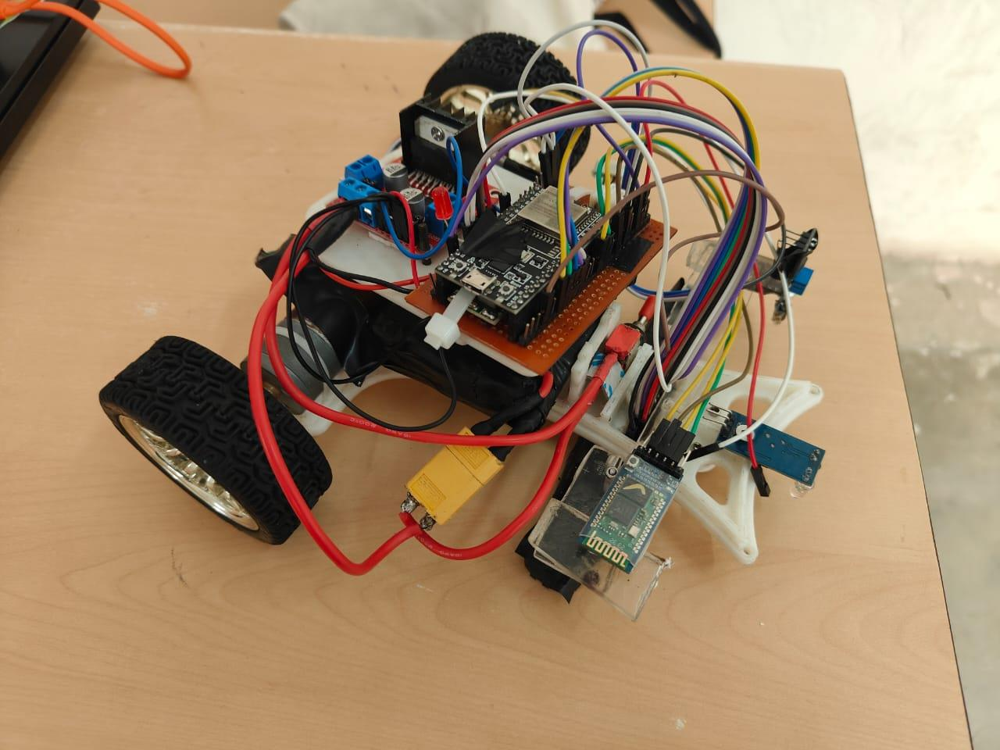
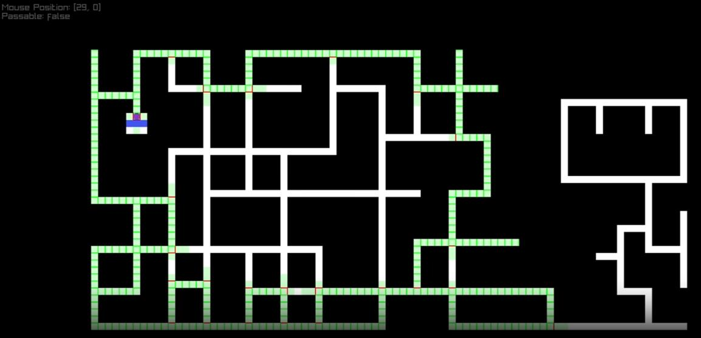

## Introduction
So this October, our team decided to participate in the IITB Techfest Zonals as is tradition. We usually participate in 2 competitions, Cosmoclench & Meshmerize, with 2 teams for each competition.

Cosmoclench is simple at heart: you make an RC bot with a human driver and an arm or gripper capable of picking up a specified object and traversing an obstacle course while carrying it.

In Meshmerize (what I participated in), you make a line follower that can solve line mazes. This is different from making a micromouse, since those solve mazes with physical walls; we are operating with inverted mazes (no walls, just lines).

Not sure how to structure this document as I am writing it in retrospect, but I think I'm just going to start talking and organize the result at the end 👍

This is mostly from my own experience and I'm sure details will be missing in places I wasn't too involved in – especially chassis and electronics and such. It is my hope that my team members will help fill in the gaps.

## Design
Since we were given a deadline to come up with a parts list and a basic vision for our bot, after **many** discussions we decided to build a bot with the following:

- **L298 Motor Driver**: Because they are relatively easy to come by and we were already familiar with using one, not to mention we already had some of these. These properties came in handy since we burnt through 4 of 'em just doing construction, and it didn't give us problems once we cleaned out any motor-related electrical issues.

Overall I think it was an alright decision and I don't think I would swap it out unless for something a bit more robust with a better voltage regulator.

- **ESP32 WROOM 38pin**: We decided on this board because it had sufficient pins to accommodate our 16RC and enough left over to connect everything else, besides having built-in Bluetooth and Wi-Fi. That didn't help much though: during testing, using Wi-Fi would cause it to heat up alarmingly and using BT would disable pins that we depended on, so we resorted to attaching a BT module (HC-05) 🤡

I don't think this was a bad choice, but knowing more about the quirks of the ESP and being **very very careful** with that 3.3V and 5V rail difference would have saved us a lot of headaches and debugging time. In all honesty, considering our experience level, an Arduino Mega would have served us better.

- **Pololu 16RC QTR IR Sensor**: This was our main sensor and so nearly everything was designed *around* it. It's an expensive sensor too and not one that's easy to find, so I'd say we were lucky to call dibs on it before the other team did, though in the end it didn't matter.

I'm just disappointed we were not able to make full use of this sensor, since we weren't able to harness it for anything besides providing error values to our PID control system.

- **3D Printed Chassis**: *(Harsh, write something here, thank you)*
- **N25 Motors w/ Encoders**: We were recommended these motors by several people and, not knowing any better, decided it was as good an idea as any. I'm not entirely sure, but I think they are part of the reason that doomed us. We weren't able to source fresh motors from anywhere, so after quite some time we finally got our hands on motors from a senior, but after modifying them to change their gearboxes we unfortunately ended up with differing gear ratios and encoders that did not correspond to each other.

The critical flaw, which we were aware of but only discovered how detrimental it would be at the end of the competition, is that the motors cut out at something like 3V, since they are designed to operate at around 10-11V. Due to this we were not able to get PID to make movements as smooth as we wanted.

I think that about covers all the mission-critical parts; the other smaller parts aren't of too much consequence and I have probably forgotten them 😅

## Code Architecture
Okay, so I will probably talk the most here since I spent most of my time writing code for the bot. Initially, while waiting for components to arrive, I wanted to at least be able to complete an implementation of LSRB with some kind of maze solving and then a way to find the optimal path.

To support this research, I created a very simple simulator in C with Raylib ([undefinedDarkness/line-follower-sim](https://github.com/undefinedDarkness/line-follower-sim)) wherein one can easily test drive various algorithms and see how the bot would behave traversing several mazes. Eventually I hope to make it easier to use and potentially create a web-based version to make it more accessible.

Using this simulator, we were able to successfully implement a working version of the algorithm described in [1410.4145](https://arxiv.org/pdf/1410.4145), and after that, utilizing a simple matrix mapping, we were able to get to finding a "more optimal" path using A*.

In the end, we only got as far as implementing LSRB on the bot, and even that didn't work quite right: while the logic was sound, we were simply unable to reliably detect intersections. That was caused by the combination of brittle intersection detection code and a sub-optimal PID (caused by hardware issues).

This document was also helpful: [Pololu's line maze algorithm slides](https://www.pololu.com/file/0j195/line-maze-algorithm.pdf).

## Implementation and issues faced
This is easily going to be the longest section compared to our planning and initial building phase. Ironing out all the issues took forever and we never really finished in the end. If I had to guess, our time was spent something like this:

<figure><svg viewBox="0 0 360 180" width="360" role="img" aria-label="Donut chart: debugging wires 70%, software issues 10%, hardware failing 10%, $HIT didn't work 10%" style="font: 13px var(--display-font)"><g fill="none" stroke-width="34" transform="rotate(-90 90 90)"><circle cx="90" cy="90" r="60" pathLength="100" stroke="#FFB3BA" stroke-dasharray="70 30"/><circle cx="90" cy="90" r="60" pathLength="100" stroke="#BAE1FF" stroke-dasharray="10 90" stroke-dashoffset="-70"/><circle cx="90" cy="90" r="60" pathLength="100" stroke="#BAFFC9" stroke-dasharray="10 90" stroke-dashoffset="-80"/><circle cx="90" cy="90" r="60" pathLength="100" stroke="#FFFFBA" stroke-dasharray="10 90" stroke-dashoffset="-90"/></g><g fill="#111" text-anchor="middle" dominant-baseline="central" font-size="11"><text x="138.5" y="125.3">70%</text><text x="30" y="90">10%</text><text x="41.5" y="54.7">10%</text><text x="71.5" y="32.9">10%</text></g><g fill="currentColor"><rect x="200" y="49" width="12" height="12" fill="#FFB3BA"/><text x="220" y="59">Debugging wires</text><rect x="200" y="74" width="12" height="12" fill="#BAE1FF"/><text x="220" y="84">Software issues</text><rect x="200" y="99" width="12" height="12" fill="#BAFFC9"/><text x="220" y="109">Hardware failing</text><rect x="200" y="124" width="12" height="12" fill="#FFFFBA"/><text x="220" y="134">$HIT didn't work</text></g></svg><figcaption>Time spent on issues</figcaption></figure>

## The Story
Our initial plan was something like this:

1. Gather components
2. Build a bot that can follow a line (line follower)
3. Figure out how to do the maze solving part

Considering we had only drafted this plan on September 20th and we had to *go for the competition* on the 8th of October, we were none too confident, but we tried our best with that time limit looming over our heads. By some grace of God, before we were set to go to Bangalore, the competition was postponed to the tail end of October, on the 26th. That worked out really handily for us since we didn't have anything to show on the 8th. We had just had a couple of days to work on it after spending like 2 days sourcing an N25 motor and getting it all assembled, and as such had very little time to tune PID on the bot, so it was barely able to follow a line.

Even getting our components was an adventure. Most of the parts we had decided on we were able to get quickly, but the initial set of motors we acquired didn't work, so we had to sit on our hands for about a week and a half to get a set that worked at all. We burned quite a few of the motor drivers, so we had to get and keep spares for those. The sensor we got from the team, luckily, since it's a hard part to find on its own.

As the timeline was shifted, we all took a large breath of relief. It had given us just enough breathing room to actually have something to go to Bangalore with.

**This is where we had one of our fumbles, I'd say: we weren't able to keep our high-pitched intensity from that hectic week (before the 8th) going till the 26th.** We slowed down by a lot, and for a couple of weeks not much work was done since we had our 2nd batch of mid-sem exams. Even during the exams we worked what little we could, creating charts for testing and doing whatever small modifications we could while still waiting for some parts.

*(Not enough detail here; if anyone can write about what all we did here, that'd be great.)*

During this time, we spent a good week and a half debugging issues with the bot and burnt through like 5 L298Ns, but by the end we had a mostly functioning bot that we could trust wouldn't suddenly fail on us.

Obviously I'm glossing over a lot here, as it's been a while since then and my memory fails me.

Some of the issues we faced:

- Weak connections due to unreliable jumper cables
- Issues with power, since the ESP32 MCU works on a 3.3V rail compared to 5V

After a couple of days' work tuning the PID to a reasonable level, we started work on the maze solving part (this is like 1 week before the competition now).

We had already written a fully working algorithm for LSRB maze navigation, and later A* for path optimization, along with a specialized simulator for the same.

Porting it to the ESP wasn't a big deal since we had already written it in C11, but this is where we faced one of our big issues: **intersection detection**.

For some reason, no matter what we did, we couldn't get intersection detection to work smoothly. Our QTR16, while fine for the PID control, simply couldn't reliably detect the intersections, and in the end we even tried a janky solution with an array of 3 individual IR sensors positioned far enough apart to not cause issues *(if only they worked)*. In the end we figured out that it was also due to our N25 motors not being precise enough to make the minute movements we required for smooth PID, so our PID was jankier than we could allow *(that was the death knell)*.

It's been a while, so I'm not really able to write with as much detail and knowledge as I could at the time, but I will say it was a very, let's say, *humbling* experience, and I learnt a lot internally even if I couldn't list it out if I wanted to.

Oh yeah, the motors we got had encoders, which we spent a lot of time trying to get working, as they would allow us to accurately measure the distance we had travelled and use that in our control code (to stop at the end of every 30cm segment). But that simply didn't work: they were inconsistent with themselves. Eventually, on a senior's recommendation, we even wondered if we should try wheel odometry, taking several readings of the encoders at various speeds to try and derive some kind of relation to get some distance out.
